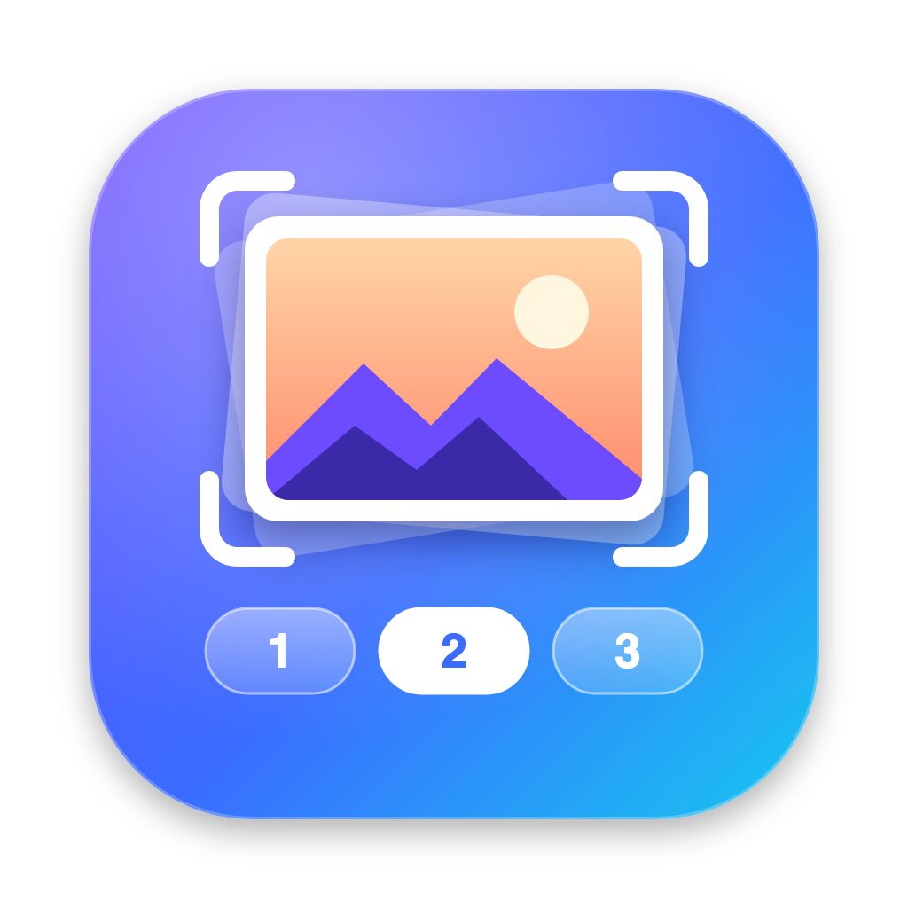
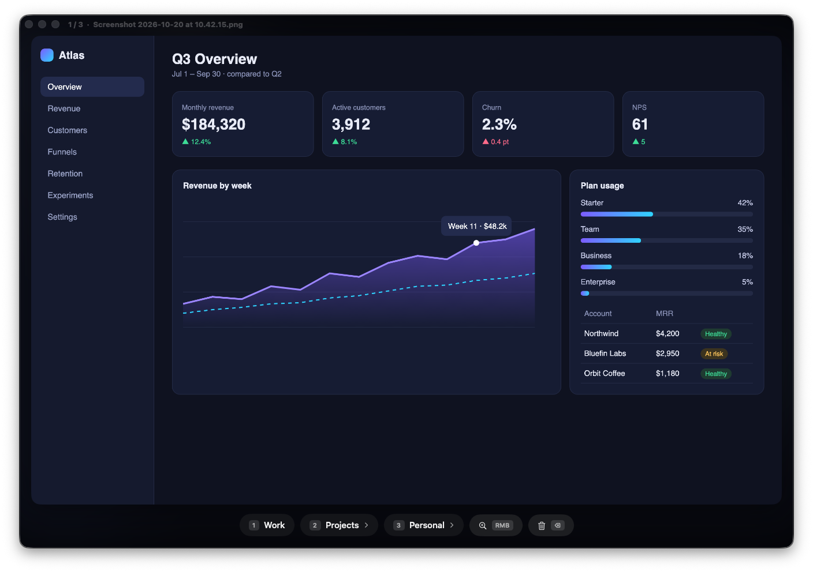
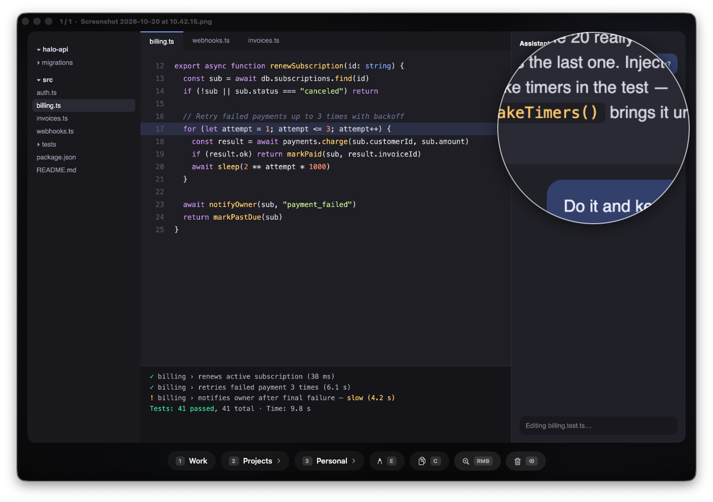

<p align="center"></p>

# Screenshooter

Sort macOS screenshots and screen recordings into folders right after you take them — with one key.

Take a screenshot (`Cmd+Shift+3/4/5`) or a screen recording and a window opens with a large preview. Press `1`, `2` or `3` and the file goes to the right folder and gets compressed in the background. A burst of screenshots is sorted one after another in the same window, with `3 / 12` progress in the title bar.



## A quick tour

**Sort with one key.** The window fits the screenshot's aspect ratio, so there are no empty bars around the preview. The progress counter and file name live in the title bar, and the bottom row holds the categories. `Work` has no subfolders, so `1` moves the file straight away. `Projects` and `Personal` have subfolders, which the chevron shows.

**Pick a subfolder.** Press `2` and the glass buttons morph into the second level: `1` keeps the file in `Projects` itself, `2…9` pick a subfolder, `N` creates a new one right from the window, and `Esc` goes back.


**Read the small print.** Hover over the preview and a loupe magnifies the area under the cursor 2.5×, so you can tell which screenshot is which without opening it. Right-click toggles the loupe.



*The screenshots above show made-up apps rendered for this README.*

## Features

- **One window for the whole queue.** The image and the counter just change; there are no pop-up dialogs.
- **Categories and subfolders**, for example `Projects → Atlas`. Create folders right from the window.
- **Liquid Glass** (macOS 26): glass buttons that morph between levels over a blurred copy of the screenshot.
- **Loupe** on hover, toggled with the right mouse button or the loupe button.
- **Drag and drop**: drag the preview into Telegram, Slack or any app to send a copy of the file.
- **Hidden from screenshots and screen recordings**, even when you capture the whole screen.
- **Background compression**: PNG losslessly (`oxipng`), video to H.265 at visually lossless quality (`ffmpeg`). Creation date and Finder tags are kept, and the original video goes to the Trash.
- **Menu bar mode**: hide the window and keep a counter of waiting files in the menu bar.
- **Full screen width** with the green button or `F`.
- **Claude integration**: a built-in MCP server lets Claude list, view and file your screenshots.

## Keys

| Key | Action |
|---|---|
| `1` `2` `3` | Category. Without subfolders the file moves at once; with subfolders the second level opens |
| `1` (second level) | Into the category itself |
| `2`…`9` (second level) | Into a subfolder |
| `N` | New subfolder (type a name, then `Enter`) |
| `Esc` | Back |
| `Delete` | Move to Trash |
| `F` | Full screen width and back |
| Right mouse button | Loupe on/off |
| Yellow / red window button | Hide to the menu bar |

## Install

Requires macOS 26 (Tahoe) on Apple Silicon. [Homebrew](https://brew.sh) is needed only for compression: `brew install ffmpeg oxipng`.

1. Download `Screenshooter-1.2.0.dmg` from the [latest release](https://github.com/lozhka13/Screenshooter/releases/latest) and drag the app to Applications.
2. Open it. On first launch it sets up `~/Screenshots/Inbox`, the screenshot location and its launch agent, then shows a status window.
3. Turn off `Cmd+Shift+5` → Options → “Show Floating Thumbnail”.

Or build from source: `git clone https://github.com/lozhka13/Screenshooter.git && cd Screenshooter && ./install.sh`.

The **[installation guide](docs/INSTALL.md)** covers the Gatekeeper prompt, categories, connecting Claude, updating, uninstalling and troubleshooting.

## Categories

Categories live in `~/Screenshots/categories.json`:

```json
[
  { "label": "Work", "folder": "Work", "subfolders": false },
  { "label": "Projects", "folder": "Projects", "subfolders": true },
  { "label": "Personal", "folder": "Personal", "subfolders": true }
]
```

`label` is the button text, `folder` is the folder inside `~/Screenshots`, and `subfolders` says whether to show the second level. The shortcut is the position in the list (up to 9). Changes apply the next time the window opens.

Subfolders come from disk: every folder inside `~/Screenshots/<folder>/` shows up on the second level in alphabetical order.

## Claude integration (MCP)

The app ships with `screenshooter-mcp`, an MCP server for Claude Code and Claude Desktop:

```bash
claude mcp add --scope user screenshooter /Applications/Screenshooter.app/Contents/MacOS/screenshooter-mcp
```

| Tool | What it does |
|---|---|
| `list_categories` | Categories, subfolders and file counts, plus unsorted Inbox |
| `list_screenshots` | Newest files, filtered by category, subfolder and date |
| `get_screenshot` | Shows a screenshot to Claude (first frame for recordings) |
| `latest_screenshot` | The most recent screenshot, optionally within a category |
| `move_screenshot` | Files a screenshot into a category or subfolder and compresses it |

Ask *“what's on my latest screenshot?”*, *“list this week's screenshots in Projects”* or *“file the Inbox screenshots of the dashboard into Projects → Atlas”*. The server only reads and writes inside `~/Screenshots`.

## How it works

| File | What it does |
|---|---|
| `Sources/Config.swift` | Paths, categories, launch environment |
| `Sources/SorterModel.swift` | Watches Inbox, queues files once they stop growing, moves and deletes files, handles keys |
| `Sources/SorterView.swift` | The window content: preview, loupe, glass buttons |
| `Sources/FlowLayout.swift` | Wraps the buttons onto rows |
| `Sources/AppDelegate.swift` | Window, menu bar item, keyboard and mouse monitors |
| `Sources/Setup.swift` | First-run setup and the status window |
| `MCP/main.swift` | The MCP server for Claude (JSON-RPC over stdio) |
| `scripts/screenshot-compress.sh` | Compresses one file in place; the app runs it after each move, one file at a time, at low priority |
| `scripts/build-app.sh` | Builds `Screenshooter.app`; `--dmg` also makes the release disk image |

A launchd `WatchPaths` agent starts the app whenever Inbox changes. Errors are logged to `~/Screenshots/.sorter.log`.

For demos and tests, `SCREENSHOOTER_HOME=/some/folder` points the app at another folder, and `SCREENSHOOTER_DEMO=1` makes the window visible to screenshots without taking focus, keys or clicks.

## Security

The [security report](docs/security-report.md) covers the Trivy scan and the manual review for the current release.

## Limitations

- The window is hidden from the system capture (`screencapture`, `Cmd+Shift+3/4/5`). Apps with their own capture (Zoom, Google Meet, OBS) may still show it on recent macOS versions.
- Video compression is not strictly lossless: H.265 CRF 22, SSIM ≈ 0.998. You can't see the difference, and screen recordings get 5–7× smaller.
- The built-in macOS screen recording captures the microphone only, not system audio.

## Uninstall

```bash
./uninstall.sh
```

This removes the app, the launch agent and the Claude MCP registration, and sends screenshots back to the Desktop. `~/Screenshots` with your sorted files stays.
