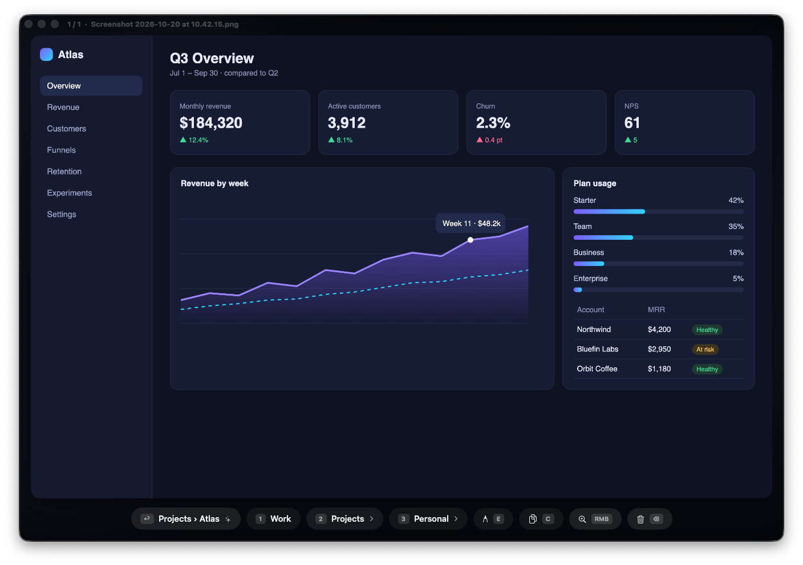
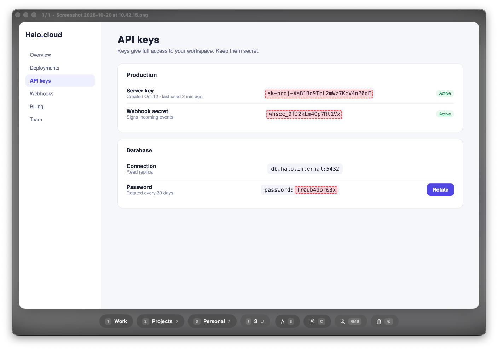
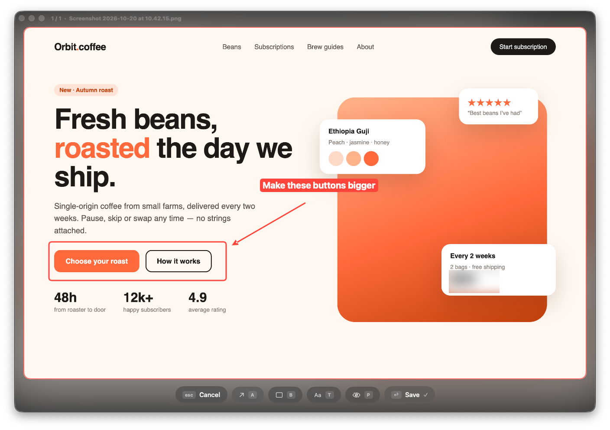

<p align="center"></p>

# Screenshooter

Sort macOS screenshots and screen recordings into folders right after you take them — with one key. Screenshooter suggests the folder, names the file, hides passwords, records calls with sound and transcribes them, and lets Claude search everything you captured.

Take a screenshot (`Cmd+Shift+3/4/5`) and a window opens with a large preview. Press `Return` to take the suggested folder or `1`, `2`, `3` to pick one, and the file is filed, renamed and compressed in the background.



## A quick tour

**It learns where things go.** Screenshooter remembers the app, the browser tab and the text of every screenshot you file. The next screenshot of the same page or screen gets a suggestion — here `Projects › Atlas` — and `Return` files it. Keywords per category (`grafana`, `verstka.agency`) work from day one.

**It catches secrets before you share them.** Text on every screenshot is recognized on your Mac. Passwords, API keys, tokens and card numbers get a red frame, and `R` pixelates them in the file.



**Mark it up without another app.** `E` opens the editor: arrows, boxes, text and blur, saved into the file. The original goes to the Trash, so `⌘Z` brings it back.



**Subfolders and new folders from the keyboard.** Categories with subfolders open a second level: `1` keeps the file in the category, `2…9` pick a subfolder, `N` creates one.


**Read the small print.** Hover over the preview and a loupe magnifies it 2.5×. Right-click toggles it.


*The screenshots above show made-up apps rendered for this README.*

## Features

**Sorting**
- One window for the whole queue with `3 / 12` progress; the window fits the screenshot's shape.
- Folder suggestions learned from your choices, plus keywords per category.
- Readable file names from the page title, window title or main heading: `2026-10-20 10.42.15 — Q3 Overview.png`.
- `⌘Z` undoes the last move, delete or edit — also from the menu bar.
- `C` copies the image to the clipboard; drag the preview into any chat to send a copy.

**Privacy**
- Passwords, keys, tokens and card numbers are detected and blurred with one key.
- The window is hidden from screenshots and screen recordings.
- Text recognition and transcription run on your Mac; nothing is uploaded.

**Recording**
- `⌃⌥⌘R` or the menu bar records the screen with system audio (calls, videos) and your microphone.
- Recordings are transcribed on your Mac into a `.txt` next to the video — English, Russian and other languages.

**Claude**
- A built-in MCP server lets Claude search screenshots by their text, view them, file them and read transcripts — handy for meeting digests.

**Housekeeping**
- Lives in the menu bar and opens at login; nothing runs in the Dock.
- Compresses after sorting: PNG losslessly, video to H.265 at visually lossless quality.
- Settings window for categories, recording, transcription and Claude; English and Russian UI; update checks.

## Keys

| Key | Action |
|---|---|
| `Return` | Take the suggested folder |
| `1` `2` `3` … | Category (second level: `1` — the category itself, `2…9` — subfolders) |
| `N` | New subfolder |
| `Esc` | Back |
| `Delete` | Move to Trash |
| `⌘Z` | Undo the last move, delete or edit |
| `C` | Copy to the clipboard |
| `E` | Editor: `A` arrow, `B` box, `T` text, `P` blur, `Return` save, `Esc` cancel |
| `R` | Blur detected secrets |
| `F` | Full screen width and back |
| Right mouse button | Loupe on/off |
| `⌃⌥⌘R` | Start or stop a screen recording (anywhere) |
| Yellow / red window button | Hide to the menu bar |

## Install

Requires macOS 26 (Tahoe) on Apple Silicon.

```bash
brew install --cask lozhka13/tap/screenshooter
```

Or download `Screenshooter-2.0.0.dmg` from the [latest release](https://github.com/lozhka13/Screenshooter/releases/latest) and drag the app to Applications. For compression install `brew install ffmpeg oxipng`.

The **[installation guide](docs/INSTALL.md)** covers the first launch, permissions, categories, connecting Claude, updating and troubleshooting.

## Categories

Edit them in **Settings → Categories** or in `~/Screenshots/categories.json`:

```json
[
  { "label": "Work", "folder": "Work", "subfolders": false, "keywords": ["grafana", "jira"] },
  { "label": "Projects", "folder": "Projects", "subfolders": true },
  { "label": "Personal", "folder": "Personal", "subfolders": true }
]
```

Up to 9 categories; the key is the position in the list. Subfolders come from disk — every folder inside `~/Screenshots/<folder>/` shows up on the second level.

## Claude integration (MCP)

```bash
claude mcp add --scope user screenshooter /Applications/Screenshooter.app/Contents/MacOS/screenshooter-mcp
```

| Tool | What it does |
|---|---|
| `list_categories` | Categories, subfolders and file counts, plus unsorted Inbox |
| `list_screenshots` | Newest files, filtered by category, subfolder and date |
| `search_screenshots` | Find files by their text, page title, address, app, name or transcript |
| `get_screenshot` | Show a screenshot to Claude, with where it was taken |
| `latest_screenshot` | The most recent screenshot, optionally within a category |
| `move_screenshot` | File a screenshot into a category or subfolder |
| `list_recordings` | Screen recordings and whether each has a transcript |
| `get_transcript` | The transcript of a recording; transcribes it on demand |

Ask *“find the screenshot with the 502 error”*, *“summarize yesterday's call recording: decisions and who does what”* or *“file the Inbox screenshots of the dashboard into Projects → Atlas”*. The server only reads and writes inside `~/Screenshots`.

## How it works

A Swift package with three products:

| Path | What it is |
|---|---|
| `Sources/ScreenshooterCore` | Shared logic: paths, categories, file moves, metadata, text recognition, secret detection, file names, suggestions, transcription, marks rendering |
| `Sources/Screenshooter` | The menu bar app: sorting window, editor, recorder, settings, updater |
| `Sources/screenshooter-mcp` | The MCP server (JSON-RPC over stdio) |
| `Tests/ScreenshooterCoreTests` | Unit tests (`swift test`) |
| `scripts/build-app.sh` | Builds `Screenshooter.app`; `--dmg` also the disk image |
| `scripts/screenshot-compress.sh` | Compresses one file in place |

Where a screenshot came from (app, browser tab, window) and its recognized text are stored in an extended attribute on the file, so they travel with it. What you taught the suggestions lives in `~/Screenshots/.screenshooter/learned.json`.

**Development:** `swift test` runs the tests, `scripts/build-app.sh` builds the app. `SCREENSHOOTER_HOME=/some/folder` points everything at another folder; `SCREENSHOOTER_DEMO=1` shows the window to screenshots without taking focus (with `SCREENSHOOTER_DEMO_OPEN`, `SCREENSHOOTER_DEMO_EDIT` and `SCREENSHOOTER_DEMO_LOUPE` for README shots).

## Security

The [security report](docs/security-report.md) covers the Trivy scan, the permissions the app asks for and the manual review.

## Limitations

- The app is signed ad hoc, not notarized: macOS asks for confirmation on first launch.
- Apps with their own screen capture (Zoom, Meet, OBS) may still show the sorting window.
- Video compression is visually lossless (H.265 CRF 22), not bit-exact.
- Russian transcription uses the older on-device recognizer and needs the Speech Recognition permission.

## Uninstall

`brew uninstall --cask screenshooter`, or quit the app from the menu bar and delete it; then `./uninstall.sh` puts screenshots back on the Desktop. `~/Screenshots` with your files stays.
